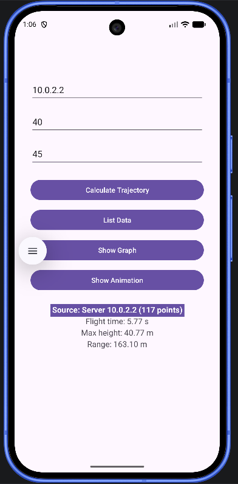
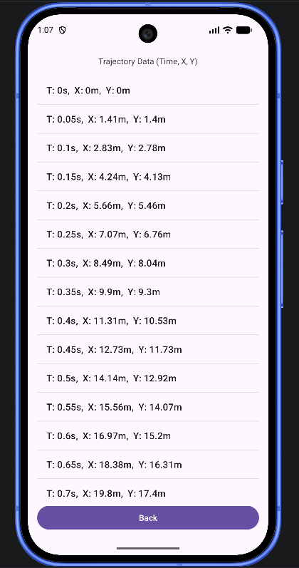
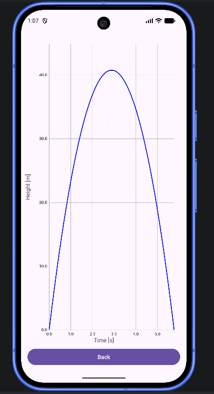
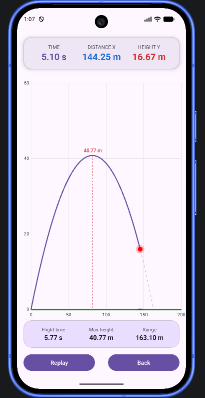

# Šikmý vrh – Android aplikácia

Aplikácia šikmého vrhu vytvorená v Android Studiu.

## 1: Aplikácia šikmého vrhu

Mobilná aplikácia realizujúca šikmý vrh. Používateľ zadá počiatočnú rýchlosť
a uhol výstrelu. Aplikácia vypočíta trajektóriu a zobrazí:
- numerický výpis (čas, pozícia x, pozícia y),
- animáciu pohybu,
- graf závislosti výšky od času y(t).

## 2: Klient-server aplikácia

Server prijme vstupné údaje od klienta (počiatočná rýchlosť, uhol výstrelu),
vygeneruje časové hodnoty trajektórie (vzdialenosť a výška letu) a pošle ich
späť klientovi. Klient (mobilná aplikácia) údaje zobrazí ako numerický výpis,
animáciu a graf.

## Ukážky aplikácie

| Zadanie parametrov | Numerický výpis | Graf y(t) | Animácia |
|---|---|---|---|
|  |  |  |  |
  |  |  |  |  |
